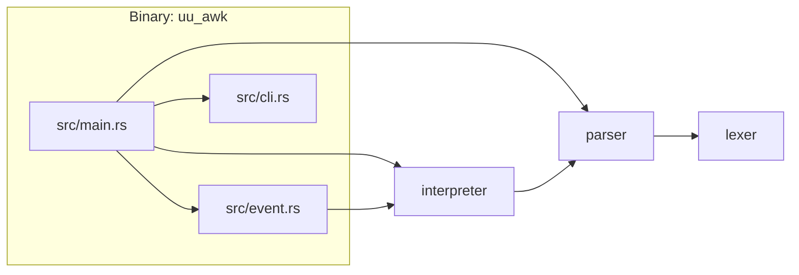
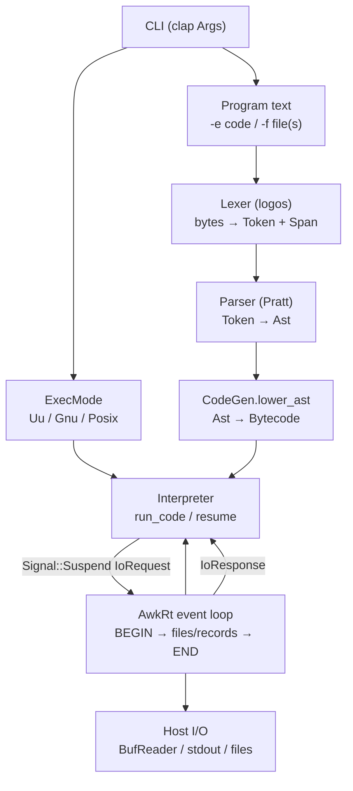
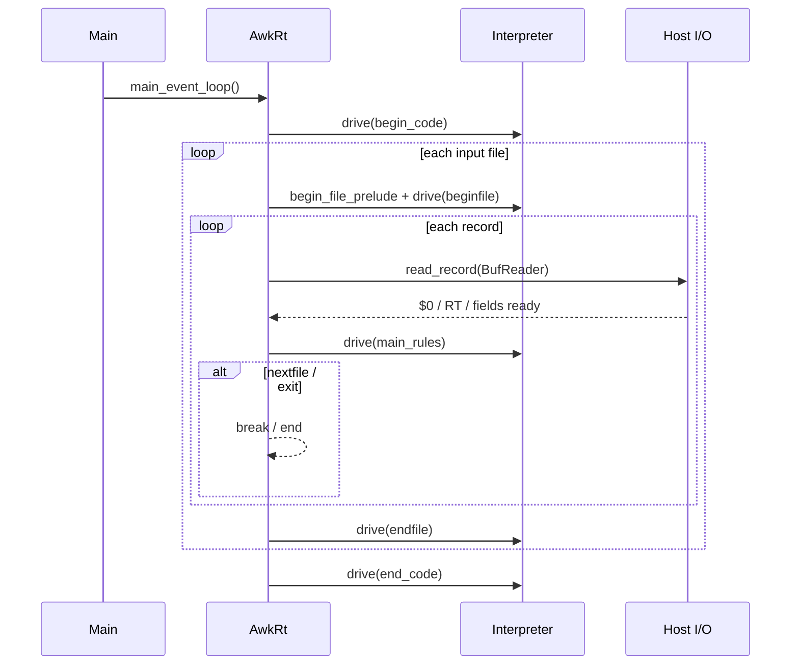
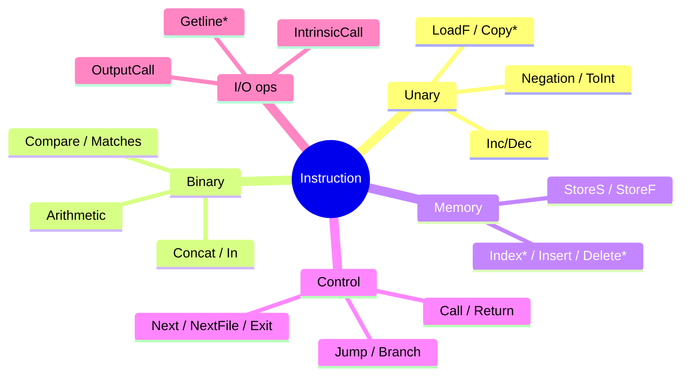
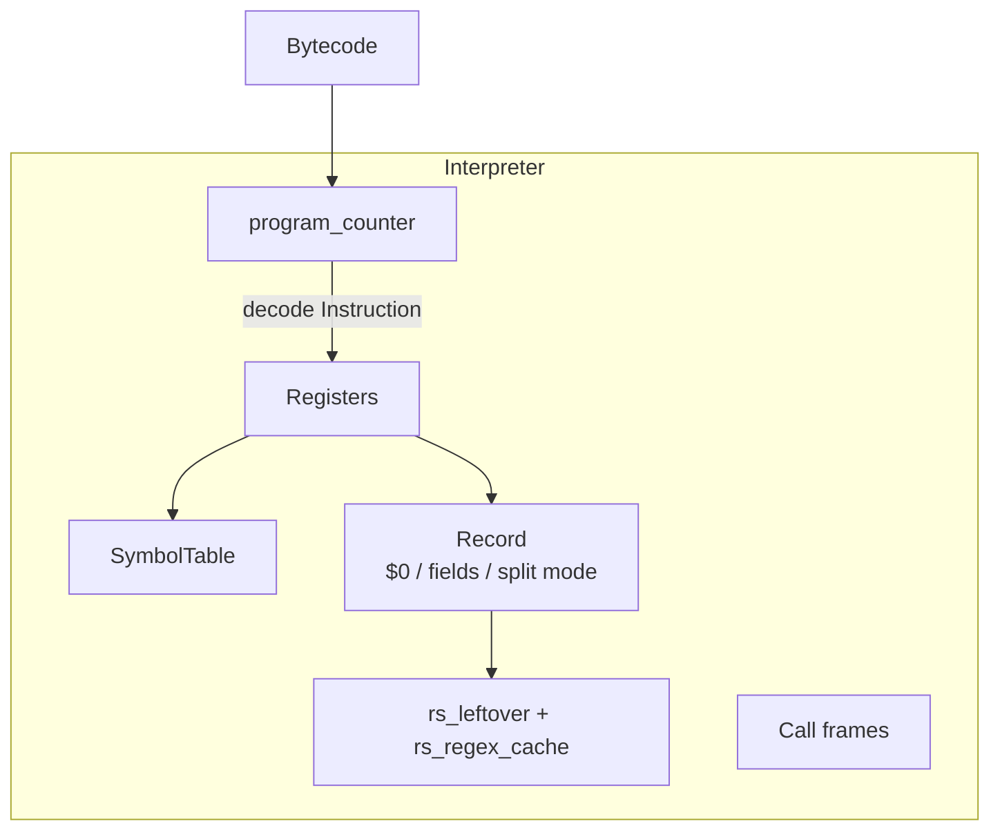
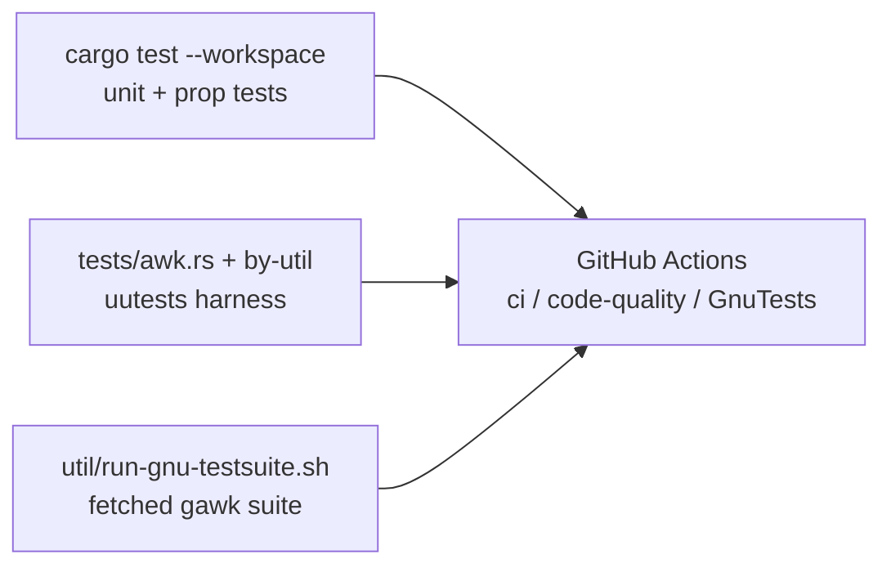

# uutils/awk — Technical Architecture

Personal notes on the technical framework of
[uutils/awk](https://github.com/uutils/awk). Not an official project doc.
Branch: `docs/architecture-overview` (fork-only; no PR intended).

Snapshot: based on `main` around the Rust **1.96.1** toolchain, workspace crates
`lexer` → `parser` → `interpreter`, binary crate `uu_awk`.

---

## 1. Goals (from project README)

| Goal | Implication for the design |
|------|----------------------------|
| Drop-in `gawk` replacement | Observed GNU behavior is the oracle; differences are bugs |
| Cross-platform | Linux / macOS / *BSD / Windows / WASI; Unix helpers gated with `cfg` |
| Memory safety + performance | Arena allocation (`bumpalo`), compact bytecode, `inline` hot paths |
| Better diagnostics | `ariadne` spans from lexer/parser through the VM |
| No GPL in-tree | gawk testsuite fetched at test time; never copy GNU **source** |

---

## 2. Repository layout

```text
awk/
├── src/                 # Binary crate uu_awk (CLI + event loop)
│   ├── main.rs          # parse → lower → Interpreter + AwkRt
│   ├── cli.rs           # clap Args, file/code queue
│   ├── event.rs         # BEGIN / per-file / per-record / END driver
│   └── utils.rs         # panic/exit helpers
├── lexer/               # logos tokenizer (bytes → Token)
├── parser/              # Pratt parser → AST + diagnostics
├── interpreter/         # AST → bytecode → VM
│   └── src/
│       ├── ir.rs        # Instruction ISA, Arg/Place, BuiltInVar
│       ├── ir/lower.rs  # CodeGen / Bytecode
│       ├── builtins.rs  # IntrinsicCall implementations
│       └── vm/          # Interpreter, values, symbols, I/O, regex
├── tests/               # uutests integration (by-util/test_awk.rs)
├── util/                # gawk testsuite harness
└── .github/workflows/   # CI, code-quality, GnuTests comparison
```

### Crate dependency graph



Workspace members (`Cargo.toml`): `lexer`, `parser`, `interpreter`.  
Binary package name: `uu_awk`; installed binary name: `awk`.

---

## 3. End-to-end execution pipeline



### Phase responsibilities

| Phase | Crate / module | Function |
|-------|----------------|----------|
| CLI | `src/cli.rs` | Options (`-f`, `-e`, `-c`/`-P`, lint, debug, …), input file queue |
| Lex | `lexer` | Tokenize program bytes; locale encoding helpers |
| Parse | `parser` | Build AST; collect `DiagnosticStore` + span metadata |
| Lower | `interpreter::ir::lower` | Emit `Instruction` stream + labels for BEGIN/rules/END/functions |
| Mode | `ExecMode` | Compatibility knobs (e.g. Posix RS first-char, `FS=""`) |
| Run | `Interpreter` | Execute bytecode; suspend for I/O |
| Drive | `AwkRt` | Classic awk phases; open files; call `read_record` |

---

## 4. Classic awk event model (`AwkRt`)

gawk-style phases, implemented in `src/event.rs`:



Control signals from the VM (`CtrlSig`): `End`, `Next`, `NextFile`, `Exit(code)`.  
I/O is **not** done inside the VM directly: the VM returns `Signal::Suspend(IoRequest)`; `AwkRt` performs the syscall/stdio work and `resume`s.

---

## 5. Lexer (`lexer`)

| Item | Detail |
|------|--------|
| Engine | [`logos`](https://docs.rs/logos) over `&[u8]` |
| Output | `Token<'a>` + byte `Span` (`Range<usize>`) |
| Names | `Identifier { namespace, literal }` (e.g. `awk::…`) |
| Strings | `Slice` / string & regex literals as raw bytes |
| Encoding | `locale_encoding` + `encoding_rs` for non-UTF-8 awareness |
| Errors | `LexingError` → fed into parser diagnostics |

The lexer is **expression-aware** in places (context for `/regex/` vs division) via logos extras / callbacks.

---

## 6. Parser (`parser`)

| Item | Detail |
|------|--------|
| Style | Pratt / precedence climbing (`pratt.rs`) for expressions |
| AST | `ast.rs` — rules, patterns, statements, expressions, places |
| Program shape | `BEGIN` / `BEGINFILE` / pattern–action / `ENDFILE` / `END` + functions |
| Diagnostics | `ariadne` reports; `DiagnosticStore` flushed before run |
| Metadata | `MetadataStore<AriadneSpan>` maps bytecode ops back to source |
| Pretty-print | optional dump of AST (`--pretty-print` / related CLI) |

Dependency: **parser → lexer** only (no VM types in the parser).

---

## 7. Intermediate representation & lowering

### Bytecode shape

- `Bytecode`: contiguous `Instruction` buffer + parallel metadata ids, plus
  labeled ranges: begin / beginfile / main rules / endfile / end / functions.
- `CodeGen::lower_ast` walks the AST and emits ops into arena-backed storage.
- Instructions are packed (`≤ 16` bytes); operands use a tagged `Arg` union
  (`Reg` / `Imm` / const / user var / builtin var) with separate `ArgTy` /
  `PlaceTy` discriminants.

### Instruction families (summary)



Lowering lives in `interpreter/src/ir/lower.rs` (largest IR file). User
functions get their own code ranges and register high-water marks.

---

## 8. Virtual machine (`interpreter::vm`)



| Component | Role |
|-----------|------|
| `Interpreter` | Fetch/decode/execute loop (`run_code` / `resume`) |
| `Registers` | Per-frame register file (arena `Vec`) |
| `SymbolTable` | Builtins (`FS`, `RS`, `RT`, `NF`, …) + user globals |
| `Record` | Current `$0`, field spans, `SplitMode` (FS / FPAT / FIELDWIDTHS) |
| `rs_leftover` / `rs_regex_cache` | Regexp-`RS` buffering and automaton reuse |
| `ExecMode` | `Uu` / `Gnu` / `Posix` — affects RS, empty FS, regex dialect |
| `Value` | Dynamic awk values: int/num/str/array/regex/… (`vm/types.rs`) |
| `builtins` | `IntrinsicCall` targets (math, string, …) |
| `vm/io.rs` | Record reading: char RS, regexp RS, blank-line `RS=""` |
| `vm/regex.rs` | `minrx` automaton builder (Posix vs GNU extensions) |

### Field splitting modes

| Mode | Trigger | Behavior (high level) |
|------|---------|------------------------|
| FS whitespace | default `FS` | Split on runs of space/tab/newline |
| FS single char | one-char `FS` | Fast `memchr` / UTF-8 char split |
| FS regex | multi-char `FS` | Regex split |
| FS per char | `FS=""` (non-Posix) | One field per character |
| FS Posix empty | `FS=""` + Posix | Whole record is `$1` |
| FPAT | `FPAT` assigned | Regex *find* fields |
| FIELDWIDTHS | `FIELDWIDTHS` assigned | Fixed widths / `skip:width` / `*` |

### Record separators (`RS`)

| `RS` | Non-Posix | Posix |
|------|-----------|-------|
| `""` | Blank-line records; `RT` = separator newlines | same idea |
| one character | Delimiter + `RT` | same |
| multi-character | **Regexp** (gawk extension), cached automaton | **First character only** |

---

## 9. Host / binary layer

| Module | Function |
|--------|----------|
| `cli.rs` | Full gawk-ish flag surface (subset implemented); builds read queue |
| `main.rs` | Orchestrates arenas, parse, lower, optional bytecode dump, starts `AwkRt` |
| `event.rs` | Phase driver + concrete I/O for `IoRequest` |
| `utils.rs` | Consistent panic → exit code mapping |

Arenas: short-lived AST bump in `main`; longer-lived runtime bump for codegen /
VM values.

---

## 10. Testing strategy



| Layer | Location | Notes |
|-------|----------|-------|
| Unit | next to crates (`lexer/tests`, `parser/tests`, `vm` modules) | Fast, no process spawn |
| Integration | `tests/by-util/test_awk.rs` | Black-box `awk` via `uutests` |
| GNU suite | `util/fetch-gnu.sh` + `run-gnu-testsuite.sh` | Compare vs `main` in CI (`GnuTests.yml`) |
| Lint | `rustfmt`, `clippy -D warnings`, `deny.toml`, cspell | code-quality workflow |

---

## 11. Compatibility & platforms

| Concern | Mechanism |
|---------|-----------|
| Toolchain | `rust-toolchain.toml` (pinned channel) |
| Posix / traditional | CLI `-P` / `-c` → `ExecMode::Posix` |
| Low-priority targets | Windows / Cygwin / `wasm32-wasip1` `cargo check` |
| Intermittent GNU fails | `.github/workflows/ignore-intermittent.txt` |

---

## 12. Design themes (how the pieces fit)

1. **Pipeline, not a monolith** — lex / parse / lower / execute are separate
   crates with one-way dependencies.
2. **Suspendable VM** — keeps the core free of direct `std::fs` / stdio; the
   binary owns the event loop and host effects.
3. **Spans everywhere** — diagnostics and optional bytecode listing stay tied
   to source locations.
4. **Arenas for throughput** — AST and much of the runtime allocate in
   `bumpalo` instead of the global allocator on hot paths.
5. **Behavior-first compatibility** — FIELDWIDTHS, RS/RT, Posix quirks are
   validated against **observed** gawk output and manuals, not by importing GNU
   code.

---

## 13. Quick map: “where do I change X?”

| Want to change… | Start here |
|-----------------|------------|
| New CLI flag | `src/cli.rs`, wire in `main.rs` / `event.rs` |
| Token / keyword | `lexer/src/lib.rs` |
| Syntax / AST node | `parser/src/ast.rs`, `pratt.rs`, `lib.rs` |
| New bytecode op | `interpreter/src/ir.rs` + `ir/lower.rs` + `vm.rs` match arm |
| Builtin function | `builtins.rs` + IR `BuiltinFunction` |
| `$0` / fields / FS | `vm/symbols.rs` (`Record`, `SplitMode`) |
| `RS` / `RT` / getline records | `vm/io.rs` |
| Regex dialect | `vm/regex.rs` + `ExecMode` |
| BEGIN/END phasing | `src/event.rs` |
| Integration test | `tests/by-util/test_awk.rs` |

---

## 14. Related links

- Upstream: https://github.com/uutils/awk  
- Status / roadmap issue: https://github.com/uutils/awk/issues/16  
- Review bar: https://uutils.org/reviews/  
- gawk manuals (behavior reference only; do not copy GPL source)

---

*Last updated for personal fork branch `docs/architecture-overview`.*
